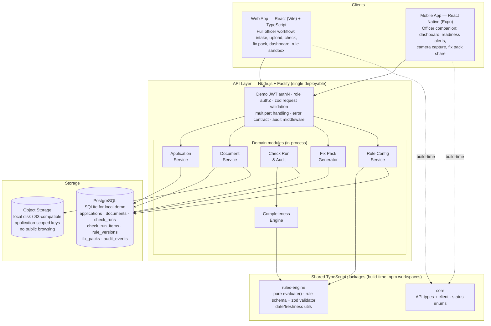
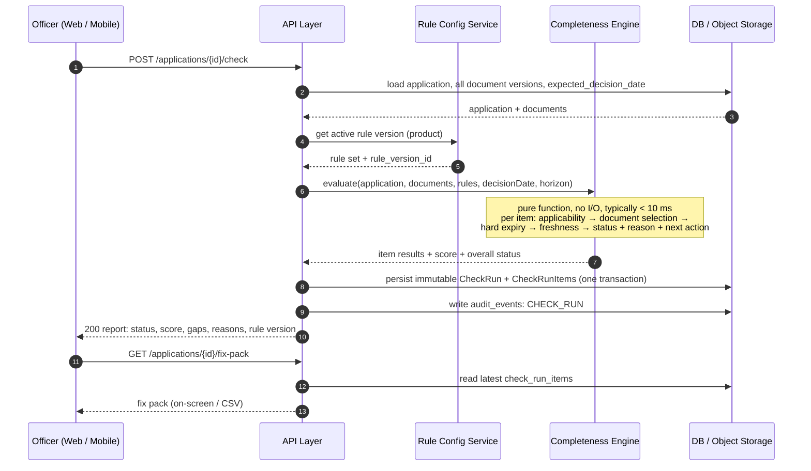

# Technical Requirements Document

## ReadyFile — Loan Document Completeness Checker (Hackathon MVP)

> **Know at intake. Decide on time.**

| Item | Detail |
| --- | --- |
| Document version | 1.2 (Markdown edition) |
| Date | 16 November 2026 (v1.0) · converted and extended 20 November 2026 |
| Source documents | ReadyFile BRD v1.2; ReadyFile PRD v1.3 |
| Scope | Web application, mobile companion app, backend API, rules engine |
| Audience | Hackathon engineering team, technical mentors, judges |
| Status | Draft for build |
| Source | `ReadyFile_TRD.docx` v1.0, QMind notebook `ReadyFile` |

### About this edition

Faithful Markdown conversion of TRD v1.0 with **four gap-fill additions** and three repairs:

> 🆕 **[GAP FILL]** — added 2026-11-20, not present in the original v1.0.

1. **§7.7 Module Data-Source and API Map** — §7 described each module's behaviour but never stated which tables a module may read, which it may write, or which endpoints expose it. Without that boundary, "modular monolith" is a claim rather than a constraint.
2. **§5.4 / §6.4 Web + Mobile Delivery Plan** — §18 gave a build order but no per-client milestones, exit criteria, or demo-readiness gates. Added a dated delivery plan with fallbacks.
3. **§12.1 Access Control Matrix** — SEC-04 specified *authentication* (demo JWT) but no *authorization*. Any authenticated user could edit any product's rules and read any application. A role/permission matrix is now specified.
4. **§12.2 Audit Log Specification** — §7.4 audited check runs only. Logins, uploads, rule saves, warning acknowledgments, exports, and denials were unrecorded, which fails the Compliance persona and BRD pain point P5. An append-only `audit_events` table and event taxonomy are now specified.

**Repairs to conversion damage in v1.0:**

| Location | Problem in v1.0 | Fix |
| --- | --- | --- |
| §3.1, §11 | Architecture and sequence diagrams were embedded PNGs on signed OSS URLs with `Expires=1795315295` — **they expire on 2026-11-20**, i.e. the diagrams were already dead on arrival in this Markdown edition | Replaced with Mermaid source (text, versionable, renders offline) |
| §8 | Rule-config JSON was split and reordered by the docx→markdown conversion into invalid JSON; field named `warning_horizontal_days` | Reconstructed as valid JSON; field corrected to `warning_horizon_days` |
| §9 | Column names concatenated by conversion (`processingsldays`, `expecteddecisiondate`, `ruleversionid`, `warningsackknowledge`, table `fix Packs`) | Normalised to snake_case |
| §10 | Example check response JSON split across three blocks, with a truncated `credit_bureau_report` item | Reconstructed as one valid document |

---

## 1. Purpose and Scope

This document translates the ReadyFile BRD and PRD into technical requirements: system architecture, technology choices, client applications (web and mobile), service specifications, the deterministic rules engine, data model, API contracts, security controls, deployment, testing, and requirement traceability.

The system implements the PRD's four differentiating capabilities: decision-date expiry forecast, one-click borrower fix pack, explainable readiness score, and policy-as-configuration sandbox — plus the recheck timeline and audit evidence.

**Out of scope**, per PRD §6.2: OCR/AI extraction, fraud/authenticity checks, LOS/core banking integration, real borrower email/SMS sending, maker-checker rule approvals, and multi-jurisdiction rule packs.

---

## 2. Technical Goals and Constraints

| ID | Goal / constraint | Implication |
| --- | --- | --- |
| TC-01 | Hackathon time box | Single deployable backend; managed/simple storage; no microservices, no message queues |
| TC-02 | Deterministic engine (NFR-02) | Pure-function rules evaluation; no clocks or randomness inside the engine; all dates passed as inputs |
| TC-03 | Web + mobile from one codebase | TypeScript monorepo; shared types, rule schema, and date utilities across web, mobile, and backend |
| TC-04 | Check < 5 s for ≤ 20 documents (NFR-01) | In-process engine, single DB round-trips, no external network calls during a check |
| TC-05 | Configurability without code changes (NFR-04) | Rules stored as versioned JSON data, validated by schema, editable via sandbox |
| TC-06 | Synthetic data only (NFR-06) | Seed scripts generate all demo data; no real PII anywhere in repo or storage |
| TC-07 | Demo reliability | SQLite local mode, seeded scenarios, deterministic replay; cloud deploy optional |
| TC-08 🆕 | Enforce module boundaries (PRD §5.3 handoffs) | Each domain module has a declared read/write table set (§7.7); cross-module data access goes through the owning module, not the ORM |
| TC-09 🆕 | Every mutating action is attributable | No write path exists without an accompanying audit event (§12.2); enforced by API middleware, not by individual handlers |

---

## 3. System Architecture

### 3.1 Architecture diagram

> 🆕 Replaces an embedded PNG whose signed URL expired 2026-11-20.



**Key invariant:** rule configuration (JSON, versioned) is stored in the DB and evaluated **only** by the Completeness Engine. Same inputs + same rule version ⇒ same result.

### 3.2 Architecture overview

ReadyFile is a **modular monolith with two thin clients**:

- **Web app** (React + TypeScript, Vite): the primary, full-feature client for loan officers — intake, upload, check, readiness report, fix pack, dashboard, rule sandbox, check-run history.
- **Mobile app** (React Native + Expo): an officer companion — pipeline dashboard, application readiness detail, camera document capture with metadata entry, and fix pack share. Borrower fix-pack viewing is demonstrated on mobile in demo mode (no external borrower accounts in MVP).
- **API layer** (Node.js + Fastify): one deployable exposing REST/JSON endpoints; handles demo JWT auth, request validation, multipart uploads, error contract, and audit middleware.
- **Domain modules (in-process):** Application Service, Document Service, Completeness Engine, Check Run & Audit, Fix Pack Generator, Rule Config Service. Clear module boundaries allow later extraction but MVP ships as one process.
- **Storage:** PostgreSQL in cloud deployment, SQLite for local demo (same ORM schema); object storage on local disk or any S3-compatible bucket for uploaded files.
- **Shared TypeScript core package:** API request/response types, generated API client, rule JSON schema + validator, date/freshness utilities, and status enums. Consumed at build time by web, mobile, and backend via npm workspaces — it is **not** a runtime service.

### 3.3 Key architecture decisions

| ID | Decision | Rationale | Alternatives rejected |
| --- | --- | --- | --- |
| AD-01 | TypeScript end-to-end monorepo | One language, shared rule/date logic prevents web/mobile/backend drift | Separate stacks per client (duplicated logic, demo risk) |
| AD-02 | Modular monolith on Fastify | Fastest to build and debug; in-process calls meet 5 s target | Microservices (operational overhead with no MVP benefit) |
| AD-03 | Rules engine as pure function library | Determinism, unit-testability, and reuse in sandbox preview | DB-stored procedures or embedded scripting (harder to audit) |
| AD-04 | Prisma ORM with PostgreSQL/SQLite switch | One schema, local demo without Docker dependency | Raw SQL per dialect (duplication) |
| AD-05 | React Native + Expo for mobile | Camera, native share sheet, OTA demo updates via Expo Go | PWA-only (weaker camera/story for judges); fully native (too slow) |
| AD-06 | Rule versions immutable, checks reference version | Audit requirement BR-06/BR-07; sandbox preview never rewrites history | Mutable rules table (breaks auditability) |
| AD-07 | Calendar-day SLA in MVP, business-day util behind interface | PRD §10.1; interface allows stretch upgrade without engine changes | Hard-coded business-day math (scope risk) |
| AD-08 🆕 | Authorization enforced in Fastify middleware, not per-handler | A handler that forgets its check fails open. Middleware fails closed and is testable once (PC-33/34/35) | Per-route guards (inconsistent coverage) |
| AD-09 🆕 | Audit events written by middleware in the same request, append-only | Guarantees TC-09 without relying on each module remembering to log | Module-level logging calls (gaps guaranteed under time pressure) |

---

## 4. Repository and Module Layout

```
readyfile/
├── package.json                 # npm workspaces
├── packages/
│   ├── core/                    # shared types, status enums, API client
│   └── rules-engine/            # pure evaluate(), rule schema, date utils
├── apps/
│   ├── api/
│   │   └── infra/               # Fastify server, domain modules, Prisma schema, seeds
│   ├── web/                     # React (Vite) officer app
│   └── mobile/                  # Expo React Native companion app
├── docker-compose.yml           # api + postgres + minio + caddy (cloud demo)
└── seed/                        # synthetic demo scenarios (JSON)
```

**Dependency rule:** `web`, `mobile`, and `api` may depend on `core` and `rules-engine`; `core` depends on nothing; `rules-engine` depends only on `core`. **Clients never import server code.**

> 🆕 Enforced mechanically, not by convention: an ESLint `no-restricted-imports` rule fails CI if `apps/web` or `apps/mobile` imports from `apps/api`, and if `packages/core` imports anything from `packages/*`.

---

## 5. Web Application Requirements

### 5.1 Pages and routes

| Route | Page | PRD reference |
| --- | --- | --- |
| `/login` | Demo login (officer / manager / auditor roles) | PRD §4.2; TRD §12.1 |
| `/applications` | Pipeline dashboard with status filters and defect counts | PRD §8.2, PR-18 |
| `/applications/new` | Intake form: product, amount, submission date, SLA | PR-01 |
| `/applications/:id` | Detail: summary card, checklist table, upload panel, run check, readiness banner, fix pack panel, history link | PRD §8.3, PR-05…13 |
| `/applications/:id/history` | Check-run timeline with per-run rule version and results | PR-17 |
| `/rules` | Rule list per product; edit creates draft version | PR-19 |
| `/rules/preview` | Sandbox: draft rule impact on seeded applications, save as new version | PR-20 |

### 5.2 Web behavior requirements

- Status rendering uses **text + color + icon** (NFR-09); never color alone.
- Checklist table columns: document type, requirement level, uploaded count, evaluated issue date, status, reason, next action, rule ID.
- 🆕 Each evaluated row shows the **date provenance marker** — "document dates entered by officer at upload" (PRD E-19 / PC-20). The report must never imply dates were read from the document.
  - 🆕 v1.2 wording: **dates**, not "issue date". A hard-expiry-only rule (`freshness: null, hard_expiry: true` — e.g. `PS-ID-01`) has no issue date at all, only the expiry date the officer typed. Labeling that row "issue date entered by officer" would be false on exactly the rows where the marker matters most. `DATE_PROVENANCE_OFFICER_ENTRY` in `@readyfile/core` is the single source of this string.
- "Run check" button shows a spinner and renders the report in place; target < 5 s, typical < 500 ms locally.
- Readiness banner states: Incomplete (red), Complete with Warnings (amber, with **Acknowledge Warnings** action), Decision-Ready (green).
- Fix pack panel lists Missing/Expired items with borrower-friendly guidance; "Include warnings" toggle; "Export CSV" action; "Copy as text" for pasting into email.
- Upload form enforces PRD §8.4 validation client-side **and re-validates server-side**.
- Rule sandbox shows a side-by-side diff: current status vs draft-rule status per seeded application, before saving.
- State management: TanStack Query for server state; no global client store needed beyond auth context.
- 🆕 UI must **not** offer actions the current role cannot perform (TRD §12.1). Hidden, not merely disabled, so the demo never shows a 403.

### 5.4 Web Delivery Plan

> 🆕 **[GAP FILL]** Added 2026-11-20. §18 gave a build order but no per-client milestones or exit criteria, so there was no way to know whether the web app was demo-ready or merely in progress.

| Milestone | Depends on | Deliverable | Exit criteria (all must pass) | Fallback if missed |
| --- | --- | --- | --- | --- |
| **W1 — Shell** | WP1 | Vite app, routing, auth context, TanStack Query wiring, `/login` | Officer can log in and reach an empty `/applications` list without console errors | Cut `/login`; hard-code a demo token in dev build |
| **W2 — Intake** | W1, WP3 | `/applications/new`, `GET /applications` | PC-38 partial: create application in ≤ 3 clicks; product picker lists seeded products | Seed applications only; skip creation UI |
| **W3 — Upload panel** | W2, WP3 | Document upload form with full PRD §8.4 validation | E-01…E-08 all produce the specified client-side message before submission | Restrict to one document type for the demo |
| **W4 — Report spine** ⭐ | W3, WP2/WP3 | Checklist table, readiness banner, run-check action | **PC-01…PC-04, PC-06, PC-17, PC-18, PC-20 pass in the browser.** This is the demo spine | **No fallback — this is the minimum viable demo** |
| **W5 — Fix pack** | W4, WP5 | Fix pack panel, warnings toggle, CSV export, copy-as-text | PC-11…PC-16 | Drop CSV; keep on-screen panel + copy-as-text |
| **W6 — Recheck + history** | W4, WP3 | Re-run check, `/applications/:id/history` timeline | PC-42, PC-24, PC-30 | Show only the latest run in the report page |
| **W7 — Dashboard** | W2 | Status filters, defect counts, default sort | PC-05 dashboard view; blocked files sort first | Cut filters; plain list |
| **W8 — Rule sandbox** | W4, WP7 | `/rules`, `/rules/preview`, side-by-side diff | PC-21…PC-27 | Demonstrate a config-file edit + redeploy instead (weaker but valid for PG-05) |
| **W9 — Accessibility + E2E** | W4–W8 | Playwright demo script, a11y pass | PC-40, PC-41 pass; PC-38 ≤ 8 clicks; E2E green against seeded local demo | Manual rehearsal checklist replaces E2E |

⭐ **W4 is the critical milestone.** Per §19 risk "dashboard overbuilt," W7 and W8 must not start until W4 exit criteria pass.

---

## 6. Mobile Application Requirements

### 6.1 MVP scope (companion, not parity)

| Screen | Capability | Priority |
| --- | --- | --- |
| Login | Demo JWT login, token in secure storage | Must |
| Dashboard | Application list with readiness status, score, defect counts; filter chips | Must |
| Application detail | Read-only checklist report with reasons; pull-to-refresh re-fetch; "Run check" trigger | Must |
| Capture & upload | Camera capture or file pick; document type picker; issue/expiry date entry; upload with retry | Must |
| Fix pack | View fix pack; native share sheet (text/CSV) — demo stands in for borrower delivery | Should |
| Borrower view (demo) | Read-only fix pack screen styled for borrower, opened from share link in demo mode | Stretch |

### 6.2 Mobile technical requirements

- Expo SDK, React Native, TypeScript; runs in **Expo Go** for judging (no app-store build needed).
- Shared core package for API client and types; **identical status enums and reason strings as web**.
- Camera via `expo-camera` / `expo-image-picker`; images compressed to ≤ 2 MB before upload; original resolution retained only if under limit.
- Auth token stored via `expo-secure-store`; **never** in plain async storage.
- Upload uses multipart with progress indicator and one automatic retry on network failure; **idempotency key per upload** to prevent duplicates (E-09).
- Read caching: last fetched dashboard/report persisted for instant open; stale banner shown when offline. **Offline writes are out of scope** — capture requires connectivity to submit (E-24).
- Push notifications, background sync, and biometric login are post-MVP.
- Deep link `readyfile://applications/:id` opens detail (used in demo share flow).

### 6.4 Mobile Delivery Plan

> 🆕 **[GAP FILL]** Added 2026-11-20. Mobile is the highest-risk client (judge-device camera variance, per §19) and had no milestones or abort criteria.

| Milestone | Depends on | Deliverable | Exit criteria | Fallback if missed |
| --- | --- | --- | --- | --- |
| **M1 — Boot** | WP1 | Expo project, TS config, core package import, secure-store token | App builds and runs in Expo Go on **both** one Android and one iOS device | Web-only demo; mobile becomes a static screenshot deck |
| **M2 — Read path** | M1, WP3 | Login, dashboard list, application detail read-only | Dashboard and report render with identical status strings to web | Cut detail screen; dashboard only |
| **M3 — Capture + upload** ⭐ | M2, WP3 | Camera capture, compress ≤ 2 MB, type picker, date entry, upload with idempotency key | **PC-39 ≤ 6 taps**; E-01/E-05/E-06/E-09/E-10 behave per spec on a real device | Fall back to `expo-image-picker` file pick only (no camera) |
| **M4 — Recheck trigger** | M3 | "Run check" from detail, pull-to-refresh | PC-42 demonstrable on device | Trigger the check from web instead |
| **M5 — Fix pack share** | M2, WP5 | Fix pack view, native share sheet | Share produces readable text/CSV in the target app | Show fix pack on screen without share |
| **M6 — Borrower demo view** | M5 | Styled read-only borrower screen via deep link | Deep link opens the screen | Cut (stretch) |

**Mobile abort rule.** If **M1** is not green on two physical devices by the end of WP6, stop mobile work and redirect the time to W5–W9. Mobile is a companion; the web app carries the demo. Per §19, a pre-recorded mobile capture clip is the stage backup regardless.

**Device matrix for rehearsal:**

| Device | OS | Expo Go | Camera verified | Notes |
| --- | --- | --- | --- | --- |
| *(fill in)* | Android | ☐ | ☐ | HEIC→JPEG conversion path must be verified (risk table, §17) |
| *(fill in)* | iOS | ☐ | ☐ | Verify `expo-secure-store` on a physical device, not a simulator |

---

## 7. Backend Service Specifications

### 7.1 Application Service

- Creates applications; computes `expected_decision_date = submission_date + processing_sla_days` (calendar days, MVP) via shared date util behind a `SlaCalculator` interface.
- Validates product exists and has an active rule version.
- Exposes status **recomputed only from the latest check run**; application status is never edited directly (PRD E-17).

### 7.2 Document Service

- Accepts multipart upload: `file` + `document_type` + `issue_date` + optional `expiry_date` + `note` + `idempotency_key`.
- Validates per PRD §8.4 and the exception catalogue E-01…E-10; stores file under application-scoped object key; records metadata row with incrementing `version` per `(application, document_type)`.
- **Evaluation selection:** latest `issue_date` per type; ties broken by latest `uploaded_at`. Superseded documents are retained.

### 7.3 Completeness Engine (`rules-engine` package)

Pure function, no I/O:

```ts
evaluate(input: {
  application: { submissionDate: ISODate; expectedDecisionDate: ISODate; attributes: Record<string, unknown> };
  documents: DocumentMeta[];      // all versions
  rules: RuleSet;                 // one immutable version
  warningHorizonDays: number;     // default 7
}): CheckResult
```

**Algorithm per rule item:**

1. **Resolve applicability:** `required | conditional | optional`; evaluate `condition` against application attributes (e.g. `employment_type == 'self_employed'`). Not applicable → `NOT_APPLICABLE`, excluded from score. 🆕 If the condition references an **absent attribute**, emit `NOT_APPLICABLE` with an explicit reason recording the missing attribute (PRD E-13) — never silently treat as satisfied.
2. **Select evaluated document** (latest issue date). None → `MISSING`.
3. **Hard expiry rule:** `expiry_date < expectedDecisionDate` → `EXPIRED`; equal → `EXPIRING_SOON`.
4. **Freshness rule:** `age = expectedDecisionDate − issue_date` (integer days); `age > max_age_days` → `EXPIRED`; `max_age_days − warningHorizon ≤ age ≤ max_age_days` → `EXPIRING_SOON`; else `PRESENT_VALID`.
5. **Emit** `{ status, reason_code, reason_text, next_action, rule_id }` for every item. Reason text embeds concrete numbers ("will be 32 days old at decision date; max 30").

**Aggregation:**

- `score = (PRESENT_VALID + EXPIRING_SOON required items) / applicable required items × 100`, rounded to integer.
- **Overall:** any required `MISSING`/`EXPIRED` → `INCOMPLETE`; else unacknowledged `EXPIRING_SOON` → `COMPLETE_WITH_WARNINGS`; else `DECISION_READY`.

**Determinism rules:** the engine receives all dates as inputs (**no `Date.now()`**), iterates rules in stable sorted order (by `rule_id`), and uses only integer day arithmetic on ISO dates at **UTC midnight** to avoid timezone drift.

### 7.4 Check Run & Audit

- Persists `CheckRun` + `CheckRunItems` in **one transaction**; rows are insert-only (no UPDATE/DELETE paths exist in code — PC-31).
- Stores `rule_version_id`, `expected_decision_date`, engine semver, and input document version IDs — sufficient to **replay any historical result** (PC-30, E-21).
- Warning acknowledgment is a separate **append-only event** referencing the check run; it never mutates item results.

### 7.5 Fix Pack Generator

- Builds from the latest check run: Missing + Expired required items; Expiring Soon only when `include_warnings=true`.
- Each entry: document type, plain-language request, freshness guidance derived from the rule (e.g. "issued within the last 30 days"), reason.
- Renders on-screen JSON and CSV (UTF-8, header row, one row per item); PDF is stretch.
- 🆕 CSV cells beginning `=`, `+`, `-`, `@` are apostrophe-prefixed (SEC-06 / PC-16).

### 7.6 Rule Config Service

- Rule sets stored as JSON documents with monotonically increasing `version` per product; saving creates a **new version** and marks it active.
- Schema validation (zod in `core`) rejects invalid drafts: unknown document types, negative `max_age_days`, missing `hard_expiry` flag (PC-25).
- **Sandbox preview:** run `evaluate()` with draft rules against seeded applications **in memory**; returns per-application before/after status; **nothing persisted until save** (PC-21).
- 🆕 Records whether a preview preceded the save, in the audit event detail (PRD E-20).

### 7.7 Module Data-Source and API Map

> 🆕 **[GAP FILL]** Added 2026-11-20. §7.1–§7.6 described behaviour without declaring data ownership. This table is the enforcement reference for TC-08 — a module touching a table outside its **Writes** column is a boundary violation and a review blocker.

| Module | Reads from | Writes to | Object storage | Exposed via | Consumes |
| --- | --- | --- | --- | --- | --- |
| **Application Service** | `products`, `rule_versions` (active flag only), `applications`, `check_runs` (latest, for derived status) | `applications` | — | `POST /applications` · `GET /applications` · `GET /applications/:id` | `SlaCalculator` (core) |
| **Document Service** | `applications`, `rule_versions` (to validate `document_type` belongs to the checklist), `documents` | `documents` | **Write** `applications/{appId}/{docId}` | `POST /applications/:id/documents` · `GET /documents/:id/stream` | MIME sniff util |
| **Completeness Engine** | *nothing — pure function* | *nothing* | — | *not exposed directly; called in-process only* | `rules-engine` package |
| **Check Run & Audit** | `applications`, `documents` (all versions), `rule_versions` | `check_runs`, `check_run_items` | — | `POST /applications/:id/check` · `GET /applications/:id/checks` · `POST /applications/:id/checks/:runId/ack-warnings` | Completeness Engine |
| **Fix Pack Generator** | `check_runs` (latest), `check_run_items` | `fix_packs` | — | `GET /applications/:id/fix-pack` · `GET /applications/:id/fix-pack.csv` | — |
| **Rule Config Service** | `products`, `rule_versions`, `applications` + `documents` (preview only, in memory) | `rule_versions` (insert new version), `products.active_rule_version_id` | — | `GET /products` · `GET /products/:id/rules` · `PUT /products/:id/rules` · `POST /products/:id/rules/preview` | Completeness Engine (preview), zod schema |
| 🆕 **Audit Middleware** | JWT claims, request context | `audit_events` | — | *no read endpoint in MVP except* `GET /applications/:id/audit` *(auditor role)* | — |

#### Boundary rules

1. **Only the Completeness Engine decides item status.** No other module may compute or override a status.
2. **Only Check Run & Audit writes `check_runs` / `check_run_items`.** Both tables are insert-only.
3. **Only Rule Config Service writes `rule_versions`.** Existing versions are never updated or deleted (AD-06).
4. **Only Document Service touches object storage.** No module constructs an object key from user input (SEC-03 — UUID keys only, preventing path traversal).
5. **Application status is derived, never written.** `applications.status` is a read-through of the latest `check_runs` row; the Application Service must not accept a status from any request body.
6. **The engine has no database handle.** Enforced by its package having no ORM dependency — a compile-time guarantee, not a convention.

---

## 8. Rule Configuration Schema

> 🆕 Repaired: v1.0's JSON was split and reordered by document conversion into invalid JSON, and named the field `warning_horizontal_days`.

```json
{
  "product_id": "personal_salaried",
  "version": 3,
  "warning_horizon_days": 7,
  "items": [
    {
      "rule_id": "PS-BANK-01",
      "document_type": "bank_statement",
      "requirement": "required",
      "condition": null,
      "freshness": { "kind": "max_age", "max_age_days": 30 },
      "hard_expiry": false
    },
    {
      "rule_id": "PS-ID-01",
      "document_type": "government_id",
      "requirement": "required",
      "condition": null,
      "freshness": null,
      "hard_expiry": true
    },
    {
      "rule_id": "PS-EVL-01",
      "document_type": "employment_verification_letter",
      "requirement": "conditional",
      "condition": { "field": "tenure_months", "op": "<", "value": 12 },
      "freshness": { "kind": "max_age", "max_age_days": 60 },
      "hard_expiry": false
    }
  ]
}
```

> 🆕 **Note on `PS-EVL-01`.** `max_age_days` is shown as **60**, not the 30 in the source documents. BRD v1.2 §6.2 found the 30-day value contradicted by a Tier A primary source (AMP published credit policy: employment letter "dated within the last 60 days"). Pending business sign-off as BRD §5.3 scope-change log entry and PRD OQ-7. Because this is configuration, the change requires no code edit — which is itself the cleanest demonstration of PG-05.

**Schema constraints (zod):**

| Field | Type | Constraint |
| --- | --- | --- |
| `product_id` | string | Must reference an existing `products.id` |
| `version` | integer | Must equal `max(existing version) + 1` for the product (else 409) |
| `warning_horizon_days` | integer | ≥ 0, ≤ 90. Denoted `H`. **Semantics (🆕 v1.2, pinned by §15.1):** for a freshness rule with `max_age_days = M`, let `A` be the document's age in days at `expected_decision_date`. `A > M` ⇒ `EXPIRED`; `M − H ≤ A ≤ M` ⇒ `EXPIRING_SOON`; `A < M − H` ⇒ `PRESENT_VALID`. The warned range is therefore **H + 1 days wide, inclusive of both boundaries** — `H = 0` warns only at `A == M`, it does not disable warnings. Matches PRD §10.7 ("`age == max_age` ⇒ Expiring Soon, not Expired") |
| `items[].rule_id` | string | Unique within the rule set; matches `^[A-Z]{2}-[A-Z]+-\d{2}$` |
| `items[].document_type` | string | Must be in the known document-type enum — unknown types rejected (PC-25) |
| `items[].requirement` | enum | `required \| conditional \| optional` |
| `items[].condition` | object \| null | **Required** when `requirement == "conditional"`; must be null otherwise. `{ field: string, op: "<" \| "<=" \| ">" \| ">=" \| "==" \| "!=", value: string \| number \| boolean }` — single comparison only; compound expressions are post-MVP |
| `items[].freshness` | object \| null | `{ kind: "max_age", max_age_days: integer ≥ 0 }`. At least one of `freshness` / `hard_expiry` must be truthy — a rule with neither cannot be evaluated |
| `items[].hard_expiry` | boolean | Required on every item; when true, `expiry_date` is mandatory at upload (E-06) |

Seed rule sets implement PRD §11 for Personal — Salaried, Personal — Self-Employed, and (stretch) Home Loan.

---

## 9. Data Model

> 🆕 Repaired: v1.0's column names were concatenated by document conversion (`processingsldays`, `expecteddecisiondate`, `ruleversionid`, `warningsacknowledge`, table `fix Packs`). Normalised below.

Prisma schema entities (PostgreSQL types; SQLite equivalents for local demo):

| Table | Columns | Constraints / notes |
| --- | --- | --- |
| `products` | `id` (pk, text), `name`, `active_rule_version_id` (fk, nullable) | Seeded |
| `rule_versions` | `id` (pk), `product_id` (fk), `version` (int), `rules_json` (jsonb), `created_at`, `created_by` 🆕 | unique(`product_id`, `version`); **insert-only** |
| `applications` | `id` (pk), `borrower_name`, `product_id` (fk), `amount` (numeric), `submission_date` (date), `processing_sla_days` (int), `expected_decision_date` (date), `attributes` (jsonb), `latest_check_run_id` (fk, nullable), `created_at`, `created_by` 🆕 | `attributes` holds condition fields (`employment_type`, `tenure_months`) |
| `documents` | `id` (pk), `application_id` (fk), `document_type` (text), `file_key` (text), `issue_date` (date), `expiry_date` (date, nullable), `note`, `version` (int), `demo_override` (bool) 🆕, `idempotency_key` (uuid), `uploaded_at`, `uploaded_by` 🆕 | unique(`application_id`, `document_type`, `version`); unique(`idempotency_key`). `demo_override` records E-07 |
| `check_runs` | `id` (pk), `application_id` (fk), `run_at`, `rule_version_id` (fk), `engine_version` (text), `expected_decision_date` (date), `score` (int), `overall_status` (enum), `warnings_acknowledged_at` (nullable), `warnings_acknowledged_by` (nullable) 🆕, `run_by` 🆕 | **insert-only**; ack fields are append-only events, never a mutation of item results |
| `check_run_items` | `id` (pk), `check_run_id` (fk), `rule_id` (text), `document_type`, `evaluated_document_id` (fk, nullable), `status` (enum), `reason_code` (text), `reason_text` (text), `next_action` (text) | **insert-only** |
| `fix_packs` | `id` (pk), `application_id` (fk), `check_run_id` (fk), `include_warnings` (bool), `export_format` (text, nullable), `generated_at`, `generated_by` 🆕 | Regenerable; stored for demo history |
| 🆕 `audit_events` | see §12.2 | **insert-only**; no UPDATE/DELETE path exists |

**Enums:**

- `item_status` = `PRESENT_VALID` | `MISSING` | `EXPIRED` | `EXPIRING_SOON` | `NOT_APPLICABLE`
- `overall_status` = `INCOMPLETE` | `COMPLETE_WITH_WARNINGS` | `DECISION_READY`

**Indexes:**

```
documents      (application_id, document_type, issue_date DESC)   -- evaluation selection
check_runs     (application_id, run_at DESC)                      -- latest run for derived status
applications   (product_id), (expected_decision_date)             -- dashboard filter + sort
audit_events   (application_id, occurred_at DESC)                 -- per-application trail
audit_events   (actor_id, occurred_at DESC)                       -- per-user trail
rule_versions  (product_id, version DESC)                         -- active version lookup
```

> 🆕 `*_by` actor columns are new in this edition. Without them the schema cannot answer "who uploaded this document?" or "who changed this rule?" — which is exactly the audit weakness BRD pain point P5 describes, and a requirement of the Compliance persona in PRD §5.

---

## 10. API Specification

Base path `/api/v1`. Auth: `Authorization: Bearer <demo JWT>` on all endpoints except `login` and `health`. Content type JSON; uploads `multipart/form-data`.

| Method & path | Purpose | Role 🆕 | Success | Errors |
| --- | --- | --- | --- | --- |
| `POST /auth/login` | Demo login (officer / manager / auditor) | public | 200 `{token}` | 401 |
| `GET /health` | Liveness + seed status | public | 200 | — |
| `POST /applications` | Create application | officer, manager | 201 `{application}` | 400, 403, 404 (product) |
| `GET /applications?status=` | Dashboard list + defect counts | officer, manager, underwriter, auditor | 200 `{items[]}` | 400 (bad filter), 403 |
| `GET /applications/:id` | Detail + latest report | officer, manager, underwriter, auditor | 200 | 403, 404 |
| `POST /applications/:id/documents` | Multipart upload + metadata | officer, manager | 201 `{document}` | 400, 403, 409 (dup idempotency key), 413, 415 |
| `GET /documents/:id/stream` 🆕 | Authenticated file download | officer, manager, underwriter, auditor | 200 binary | 403, 404 |
| `POST /applications/:id/check` | Run completeness check | officer, manager | 200 `{checkRun, items[]}` | 403, 404, 409 (no active rules) |
| `GET /applications/:id/checks` | Check-run history | officer, manager, underwriter, auditor | 200 `{runs[]}` | 403, 404 |
| `POST /applications/:id/checks/:runId/ack-warnings` | Acknowledge warnings | officer, manager | 200 | 403, 404, 409 (no warnings) |
| `GET /applications/:id/fix-pack?include_warnings=` | Generate fix pack | officer, manager, underwriter | 200 `{entries[]}` | 403, 404 |
| `GET /applications/:id/fix-pack.csv` | CSV export | officer, manager | 200 `text/csv` | 403, 404 |
| `GET /applications/:id/audit` 🆕 | Per-application audit trail | auditor, manager | 200 `{events[]}` | 403, 404 |
| `GET /products` | Product list | officer, manager, underwriter, auditor | 200 | 403 |
| `GET /products/:id/rules` | Active rule set | officer, manager, auditor | 200 `{ruleSet}` | 403, 404 |
| `PUT /products/:id/rules` | Save new rule version | **manager only** | 201 `{ruleVersion}` | 400 (schema), 403, 409 (version conflict) |
| `POST /products/:id/rules/preview` | Sandbox impact preview | officer, manager | 200 `{diffs[]}` | 400, 403 |

### Error contract (all failures)

```json
{
  "error": {
    "code": "VALIDATION_FAILED",
    "message": "issue_date is required for freshness-based documents",
    "details": [
      { "field": "issue_date" }
    ]
  }
}
```

Error codes: `VALIDATION_FAILED` (400) · `UNAUTHENTICATED` (401) · `FORBIDDEN` (403) · `NOT_FOUND` (404) · `CONFLICT` (409) · `PAYLOAD_TOO_LARGE` (413) · `UNSUPPORTED_MEDIA_TYPE` (415) · `RATE_LIMITED` (429, with `Retry-After`) · `INTERNAL` (500, message never leaks internals).

### Example check response

> 🆕 Repaired: v1.0 split this across three blocks and truncated the `credit_bureau_report` item.

```json
{
  "checkRun": {
    "id": "cr_01J...",
    "ruleVersion": 3,
    "expectedDecisionDate": "2026-11-21",
    "score": 60,
    "overallStatus": "INCOMPLETE"
  },
  "items": [
    {
      "ruleId": "PS-BANK-01",
      "documentType": "bank_statement",
      "status": "EXPIRED",
      "reasonCode": "FRESHNESS_AT_DECISION",
      "reasonText": "Will be 32 days old on 2026-11-21; max allowed is 30 days.",
      "nextAction": "Upload a bank statement issued on or after 2026-10-22.",
      "evaluatedDocumentId": "doc_01J...",
      "dateProvenance": "document dates entered by officer at upload"
    },
    {
      "ruleId": "PS-CBR-01",
      "documentType": "credit_bureau_report",
      "status": "MISSING",
      "reasonCode": "NO_DOCUMENT",
      "reasonText": "No credit bureau report uploaded.",
      "nextAction": "Upload a credit bureau report issued within the last 30 days.",
      "evaluatedDocumentId": null,
      "dateProvenance": null
    }
  ]
}
```

> 🆕 `dateProvenance` is new — it implements PRD E-19 / PC-20 so the API response itself never implies dates were read from the document.

---

## 11. Check Execution Flow

> 🆕 Replaces an embedded PNG whose signed URL expired 2026-11-20.



**Notes:**

- Steps 2–5 execute in one request; the engine call is pure and typically < 10 ms.
- The persisted check run is the **single source of truth** for dashboard status, fix pack, and history.
- Sandbox preview reuses the engine call with draft rules and **skips persistence** (PC-21).
- 🆕 If the persistence transaction fails, the whole run is rolled back and no partial result is ever visible (PRD E-14).

---

## 12. Security Requirements

| ID | Requirement | Implementation |
| --- | --- | --- |
| SEC-01 | Synthetic data only | Seed generator produces all names/amounts; CI check rejects seed files failing the synthetic marker |
| SEC-02 | Upload validation | Server-side MIME sniffing (magic bytes) + extension allowlist (pdf/jpg/png); 10 MB max per file; reject executables and polyglots |
| SEC-03 | Storage isolation | Object keys `applications/{appId}/{docId}`; downloads only via authenticated API streaming; no public bucket routes; no user-controlled paths (UUID keys prevent traversal) |
| SEC-04 | AuthN | Short-lived demo JWT (HS256, env secret); mobile token in secure store |
| SEC-04a 🆕 | **AuthZ** | Role claim in JWT, enforced by Fastify middleware per §12.1; fails closed (AD-08) |
| SEC-05 | Injection safety | Prisma parameterized queries only; no raw SQL string building; zod validation at every boundary |
| SEC-06 | XSS safety | React default escaping; `reason_text` rendered as text, never as HTML; CSV export prefixes formula-triggering cells (`=`, `+`, `-`, `@`) with an apostrophe |
| SEC-07 | Transport | HTTPS in cloud deployment (TLS at reverse proxy); local demo may use HTTP on localhost |
| SEC-08 | Secrets | Env vars only; no secrets in repo; demo JWT secret rotated per deployment |
| SEC-09 | Rate/size limits | Body limit 11 MB; per-IP rate limit on login and upload; 429 with `Retry-After` |
| SEC-10 | Audit integrity | Insert-only check tables; no delete endpoints exist in MVP |
| SEC-11 🆕 | Audit completeness | Every mutating request writes an `audit_events` row via middleware (TC-09, AD-09); denials are logged too |

> Production hardening (encryption at rest, retention policy, real IdP, full RBAC) is explicitly post-MVP per BRD NFR-03.

### 12.1 Access Control Matrix

> 🆕 **[GAP FILL]** Added 2026-11-20. v1.0 specified authentication (SEC-04) but **no authorization model** — any valid JWT could edit any product's rules and read any application. PRD §4.2 lists "complex RBAC" as a non-goal, but a *minimal* matrix is required for two reasons: the rule sandbox must have a write boundary or PG-05 demonstrates an uncontrolled change to compliance-relevant policy; and PRD PC-33/34/35 cannot be tested against an unspecified model.

#### Roles

| Role | Maps to persona (PRD §5) | Demo user | Purpose |
| --- | --- | --- | --- |
| `officer` | Loan Officer / Intake Agent | `officer@demo.local` | Full working access to applications and documents; may **preview** but not **save** rules |
| `manager` | Operations Manager + Credit Policy | `manager@demo.local` | Everything `officer` can do, plus save rule versions and view the full audit trail |
| `underwriter` | Underwriter / Credit Analyst | `underwriter@demo.local` | **Read-only** on applications, reports, and fix packs. Cannot upload, check, or edit rules — this is what makes the decision-ready gate meaningful |
| `auditor` | Compliance / Audit | `auditor@demo.local` | **Read-only** on everything including rule versions and the complete audit trail. No write path at all |

**No borrower role exists.** Borrower fix-pack viewing is a demo-mode read-only mobile screen reached by deep link (PRD §6.1, stretch); it authenticates nothing and exposes only the fix pack the officer chose to share.

#### Permission matrix

| Capability | officer | manager | underwriter | auditor | Endpoint |
| --- | :---: | :---: | :---: | :---: | --- |
| Log in | ✅ | ✅ | ✅ | ✅ | `POST /auth/login` |
| Create application | ✅ | ✅ | ❌ | ❌ | `POST /applications` |
| List / view applications | ✅ | ✅ | ✅ | ✅ | `GET /applications`, `GET /applications/:id` |
| Upload document | ✅ | ✅ | ❌ | ❌ | `POST /applications/:id/documents` |
| Download document file | ✅ | ✅ | ✅ | ✅ | `GET /documents/:id/stream` |
| Run completeness check | ✅ | ✅ | ❌ | ❌ | `POST /applications/:id/check` |
| View check-run history | ✅ | ✅ | ✅ | ✅ | `GET /applications/:id/checks` |
| Acknowledge warnings | ✅ | ✅ | ❌ | ❌ | `POST …/ack-warnings` |
| Generate fix pack | ✅ | ✅ | ✅ | ❌ | `GET …/fix-pack` |
| Export fix pack CSV | ✅ | ✅ | ❌ | ❌ | `GET …/fix-pack.csv` |
| Preview rule change | ✅ | ✅ | ❌ | ❌ | `POST /products/:id/rules/preview` |
| **Save rule version** | ❌ | ✅ | ❌ | ❌ | `PUT /products/:id/rules` |
| View active rule set | ✅ | ✅ | ❌ | ✅ | `GET /products/:id/rules` |
| **View audit trail** | ❌ | ✅ | ❌ | ✅ | `GET /applications/:id/audit` |

#### Enforcement rules

1. **Middleware, not handlers (AD-08).** A single Fastify `onRequest` hook resolves the role from the JWT and compares against a route→roles table. Missing entry in the table ⇒ **deny** (fails closed).
2. **Application-scoping is orthogonal to role.** Even an authorized role may only reach applications within the demo scope; cross-application access returns 404 rather than 403 to avoid leaking existence (PC-35).
3. **UI hides unauthorized actions** (TRD §5.2) so the demo never surfaces a 403. The server remains the authority — hiding is convenience, not control.
4. **JWT claims:** `{ sub, role, iat, exp }`. `exp` ≤ 8 hours. Role is read from the **signed token only**, never from a request header or body.
5. **Denials are audited** (`AUTH_DENIED` event, §12.2) so a judge can see the control working rather than taking it on faith.

#### Demo script for access control

Log in as `underwriter` → show that upload, run-check, and rule-save actions are absent → attempt `PUT /products/personal_salaried/rules` with the underwriter token → **403**, and the denial appears in the audit trail when viewed as `auditor`. Roughly 45 seconds, and it converts a security claim into a visible fact.

### 12.2 Audit Log Specification

> 🆕 **[GAP FILL]** Added 2026-11-20. v1.0's §7.4 audited **check runs only**. That records what was evaluated but not who acted — leaving login, upload, rule save, warning acknowledgment, export, file download, and every denial unrecorded. BRD pain point P5 is precisely *"audit trails of what was checked and when are weak,"* and the Compliance persona in PRD §5 needs *"logged evidence of what was checked, when, and against which rules."* A check-run table alone does not satisfy either.

#### `audit_events` table

| Column | Type | Notes |
| --- | --- | --- |
| `id` | text (pk) | ULID — sortable by creation time |
| `occurred_at` | timestamptz | Server UTC time |
| `actor_id` | text, nullable | JWT `sub`; **null for unauthenticated requests** (failed logins, 401s) |
| `actor_role` | text, nullable | Role at the time of the event — recorded, not joined, so a later role change cannot rewrite history |
| `action` | text | From the taxonomy below |
| `target_type` | text | `application` \| `document` \| `check_run` \| `rule_version` \| `fix_pack` \| `product` \| `session` |
| `target_id` | text, nullable | ID of the affected entity |
| `application_id` | text, nullable | Denormalised for per-application trail queries |
| `outcome` | text | `success` \| `denied` \| `error` |
| `detail` | jsonb | Action-specific payload (see taxonomy) |
| `request_id` | text | Correlates all events from one HTTP request |
| `source_ip` | text | |
| `user_agent` | text | Truncated to 256 chars |

**Constraints:** insert-only. No UPDATE or DELETE code path exists (PC-31 applies here too). Indexed on `(application_id, occurred_at DESC)` and `(actor_id, occurred_at DESC)`.

#### Event taxonomy

| Action | Trigger | `detail` payload | Outcome variants |
| --- | --- | --- | --- |
| `AUTH_LOGIN` | Successful login | `{ demo_user }` | success |
| `AUTH_FAILED` | Bad credentials | `{ attempted_user }` — never the attempted password | error |
| `AUTH_DENIED` | Valid token, insufficient role | `{ required_roles, path, method }` | denied |
| `APPLICATION_CREATE` | New application | `{ product_id, submission_date, processing_sla_days, expected_decision_date }` | success |
| `DOCUMENT_UPLOAD` | New document version | `{ document_type, version, issue_date, expiry_date, demo_override, file_size, sha256 }` | success |
| `DOCUMENT_REJECTED` | Validation/MIME failure | `{ reason_code, document_type, declared_type, detected_mime }` | error |
| `DOCUMENT_DOWNLOAD` | File streamed | `{ document_id }` | success |
| `CHECK_RUN` | Completeness check executed | `{ rule_version_id, engine_version, expected_decision_date, score, overall_status, counts_by_status, document_version_ids[] }` | success |
| `CHECK_RUN_FAILED` | Transaction rolled back (E-14) | `{ reason_code }` | error |
| `WARNINGS_ACKNOWLEDGED` | Ack action | `{ check_run_id, warning_count, acknowledged_item_ids[] }` | success |
| `FIX_PACK_GENERATED` | Fix pack built | `{ check_run_id, entry_count, include_warnings }` | success |
| `FIX_PACK_EXPORTED` | CSV/PDF download | `{ format, entry_count }` | success |
| `RULE_PREVIEW` | Sandbox preview run | `{ product_id, draft_version, applications_evaluated, status_changes }` | success |
| `RULE_VERSION_SAVED` | New active rule version | `{ product_id, old_version, new_version, preview_ran_first: bool, changed_rule_ids[], diff_summary }` | success |
| `RULE_VERSION_REJECTED` | Schema validation failure | `{ product_id, validation_errors[] }` | error |
| `SEED_RESET` | `npm run seed:reset` | `{ scenario_count }` | success |

**`sha256` on upload** costs one hashing pass and buys duplicate-document detection later (BRD §11 roadmap item 4) at zero schema-change cost.

#### What the audit log must be able to answer

These are the demo and compliance questions the design is built to satisfy:

1. *Who uploaded the bank statement that was evaluated in check run `cr_01J…`?* → `CHECK_RUN.detail.document_version_ids` → `DOCUMENT_UPLOAD` by `actor_id`.
2. *Which rule version produced this result, and who set it?* → `CHECK_RUN.detail.rule_version_id` → `RULE_VERSION_SAVED`.
3. *Was the rule previewed before it was saved?* → `RULE_VERSION_SAVED.detail.preview_ran_first` (PRD E-20).
4. *Who acknowledged the warnings that let this file become decision-ready?* → `WARNINGS_ACKNOWLEDGED`.
5. *Did anyone try to bypass the gate or the sandbox?* → `AUTH_DENIED` rows.
6. *Was this document exported to the borrower, and when?* → `FIX_PACK_EXPORTED` — note this records the **officer's export**, not borrower receipt (PRD H5 is out of band; do not overclaim delivery tracking).

#### Retention and exposure

- MVP: retained for the demo lifetime; no deletion path exists.
- `GET /applications/:id/audit` is restricted to `auditor` and `manager` (§12.1).
- 🆕 Production retention policy, immutability via WORM storage, and hash-chaining for tamper-evidence are **post-MVP** (BRD §11 item 5; NFR-03). The MVP claim is *"append-only in code"*, not *"tamper-proof"* — keep that distinction when presenting.

---

## 13. Non-Functional Implementation Targets

| PRD NFR | Technical target | Verification |
| --- | --- | --- |
| NFR-01 Performance | p95 check < 500 ms local, < 2 s cloud; hard budget 5 s | Load test script: 20 docs × 50 sequential checks (PC-36/37) |
| NFR-02 Determinism | Golden-file tests: fixed inputs ⇒ byte-identical results | CI unit suite with frozen dates (PC-28) |
| NFR-03 Usability | Demo flow ≤ 8 clicks web; ≤ 6 taps mobile capture-upload | Rehearsal checklist (PC-38/39) |
| NFR-04 Configurability | Rule edit → save → recheck with zero code changes | Sandbox E2E test (PC-26) |
| NFR-05 Auditability | Replay any run from stored inputs + rule version | Replay unit test (PC-30) |
| NFR-07 Portability | `docker compose up` (cloud) or `npm run demo` (SQLite + local disk) | Clean-machine dry run (PC-46) |
| NFR-09 Accessibility | Status text + icon + color; WCAG AA contrast on status chips | Manual audit of report page (PC-40/41) |
| 🆕 SEC-04a Authorization | Every non-public endpoint role-checked; denials audited | API tests for all four roles (PC-33/34/35) |
| 🆕 SEC-11 Audit completeness | Every mutating request produces ≥ 1 `audit_events` row | Middleware test enumerating all write endpoints (PC-32) |

---

## 14. Deployment and Environments

### 14.1 Environments

| Environment | Stack | Purpose |
| --- | --- | --- |
| Local demo | SQLite + local disk + `npm run demo` (api, web concurrently; Expo Go for mobile) | Development and stage fallback |
| Cloud demo | docker-compose: api (Node 22), postgres:16, minio, caddy (TLS) on one VM | Judges access via URL; mobile points to cloud API |

### 14.2 Configuration (env vars)

```
DATABASE_URL
STORAGE_DRIVER=local|s3
STORAGE_PATH                 # local driver
S3_ENDPOINT / S3_BUCKET / S3_ACCESS_KEY / S3_SECRET_KEY
JWT_SECRET
JWT_TTL_HOURS=8              # 🆕 SEC-04a
SLA_DEFAULT_DAYS=5
WARNING_HORIZON_DAYS=7
SEED_ON_BOOT=true|false
PORT=8080                    # bind 0.0.0.0 in cloud
MAX_UPLOAD_BYTES=10485760    # 🆕 SEC-02 / E-01
RATE_LIMIT_PER_IP=30         # 🆕 SEC-09
```

### 14.3 Demo data seeding

Seed script creates:

- **2 products** with rule v1 (3rd, Home Loan, is stretch).
- **6 applications:** happy path (Decision-Ready) · missing-only · expired-at-decision (27-day-old statement, 5-day SLA) · expiring-soon warning · self-employed conditional case · two-run history case (Incomplete → Decision-Ready).
- **4 demo users**, one per role (§12.1). 🆕
- Synthetic PDF/JPG placeholders generated locally.

Seeds are **idempotent** and resettable via `npm run seed:reset` (PC-47). Every seeded record carries the synthetic marker checked by CI (SEC-01).

---

## 15. Testing and Quality Requirements

### 15.1 Rules engine unit matrix (minimum cases)

| Case | Input | Expected |
| --- | --- | --- |
| Missing required | no document for required rule | `MISSING`, blocks readiness |
| Freshness pass | age at decision = `max_age − horizon − 1` | `PRESENT_VALID` |
| Warning boundary | age at decision = `max_age − horizon` | `EXPIRING_SOON` |
| Freshness boundary | age at decision = `max_age` | `EXPIRING_SOON` |
| Freshness fail | age at decision = `max_age + 1` | `EXPIRED` |
| Hard expiry fail | `expiry_date` = decision − 1 | `EXPIRED` |
| Hard expiry boundary | `expiry_date` = decision | `EXPIRING_SOON` |
| Conditional off | `tenure_months = 24` on EVL rule | `NOT_APPLICABLE`, excluded from score |
| 🆕 Conditional attribute absent | `tenure_months` not in attributes | `NOT_APPLICABLE` + explicit reason naming the missing attribute (E-13) |
| Version supersede | newer `issue_date` doc invalid, older valid | item `EXPIRED` (latest governs). 🆕 **Only reachable on a hard-expiry basis** — under freshness a newer `issue_date` *is* the fresher document, so "newer but invalid" cannot occur. The real shape is a renewed ID whose expiry has already passed superseding an older still-valid one; the engine must not fall back to the superseded document. The complementary freshness case (a fresh upload superseding a stale one ⇒ `PRESENT_VALID`) is tested alongside it |
| 🆕 Version tie-break | two docs, same `issue_date`, different `uploaded_at` | later `uploaded_at` evaluated |
| Score with warning | 4 valid + 1 expiring of 5 required | score 100, `COMPLETE_WITH_WARNINGS` |
| 🆕 Empty application | zero documents uploaded | all required `MISSING`, score 0, `INCOMPLETE` — no error (E-12) |
| 🆕 Decision date in the past | `expected_decision_date` < today | runs normally; freshness items `EXPIRED` (E-18) |
| 🆕 Unknown rule combination | rule with neither `freshness` nor `hard_expiry` | rejected by zod at save time, never reaches the engine (PC-25) |
| Determinism | same input twice | identical output **including ordering** |

| 🆕 Optional absent | `requirement: "optional"`, no document uploaded | `NOT_APPLICABLE` + reason `OPTIONAL_NOT_REQUIRED` — **not** `MISSING`. PRD §8.5 defines Missing as "*Required* document has no uploaded file", and §10.5 excludes optional items from scoring either way, so an absent optional document is out of scope, not a gap. An optional document that *is* uploaded is still evaluated normally, so a stale optional upload surfaces as a warning |
| 🆕 Required date null | document present but `issue_date` null on a freshness rule, or `expiry_date` null on a hard-expiry rule | Fails **closed** to `EXPIRED` with `ISSUE_DATE_ABSENT` / `EXPIRY_DATE_ABSENT`. Upload validation (E-05/E-06) should prevent it; if it happens the item is unverifiable rather than passing (BRD BR-01) |
| 🆕 Both bases configured | one rule with `freshness` **and** `hard_expiry`; freshness satisfied, expiry passed | `EXPIRED`, reason `HARD_EXPIRY_PASSED`. Both bases are evaluated and the most severe wins (§7.3 step 4) |
| 🆕 Full document tie | two docs, same `issue_date`, same `uploaded_at`, same `version` | Greatest `id` evaluated. With the row above this makes selection a **total order**, so no input can produce an order-dependent result |
| 🆕 Determinism under reordering | rules shuffled; documents shuffled | Byte-identical JSON. Stronger than "same input twice" — it catches an implementation that happens to preserve configuration or query order. Items are sorted by `rule_id` with code-unit comparison, explicitly not `localeCompare` (ICU collation varies by runtime locale) |

> 🆕 **v1.2 — findings from implementing this matrix.** Both were caught by writing the tests, not by review, which is the argument for building the matrix before the service layer.
>
> 1. **"Optional absent" was unimplemented.** The engine returned `MISSING`. Nothing blocked — `aggregate` already excluded optional items from the gate — but the row read as a gap in both clients and in the fix pack, and `ReasonCode.OPTIONAL_NOT_REQUIRED` was declared in `@readyfile/core` yet produced nowhere in the codebase. Fixed; the case is now in the table above.
> 2. **The warning boundary is easy to get wrong in the *other* direction.** `age >= M − H` is correct; `age > M − H` looks cleaner and silently moves the boundary to `M − H + 1`, breaking the "Warning boundary" row above and PRD §10.7. The formula is now written out in §8 and the test asserts all four boundaries (`M − H − 1`, `M − H`, `M`, `M + 1`) so either mistake fails loudly.
>
> **Not changed, deliberately:** a hard-expiry item warns only when `expiry_date` **equals** the decision date, not across the whole `warning_horizon_days` window. §7.3 step 3 and PRD §10.4 specify equality only, and widening it would flag IDs expiring weeks after approval, which no source in BRD §6.2 requires. Recorded so the asymmetry between the two bases reads as a decision rather than an oversight.
>
> **Client-side, not engine:** the E-18 banner ("Expected decision date … is in the past") is a presentation concern. The engine runs normally on a past decision date and returns the dates it used; WP4/WP6 render the banner.

### 15.2 Other test layers

- **API integration tests** (vitest + supertest): auth, upload validation errors, check flow, fix pack CSV, rule version conflict, immutable history. 🆕 Plus: role matrix — each endpoint × each of the four roles, asserting allow/deny per §12.1 (PC-33/34/35); and audit completeness — each write endpoint produces ≥ 1 `audit_events` row (PC-32).
- **E2E demo rehearsal** (Playwright, web): the PRD §16 demo story scripted end-to-end; runs against seeded local demo.
- **Mobile smoke** (manual checklist on Expo Go): login → dashboard → capture/upload → recheck → share fix pack; executed on one Android and one iOS device if available.
- 🆕 **Static analysis gates:** no `Date.now()` / `Math.random()` / I/O inside `packages/rules-engine` (PC-29); no UPDATE/DELETE against `check_runs`, `check_run_items`, `rule_versions`, `audit_events` (PC-31); no cross-boundary imports per §4.
- **CI:** typecheck + lint + unit + API tests on every push; E2E nightly or pre-demo.

---

## 16. Requirements Traceability

| PRD requirement | Implementing component(s) |
| --- | --- |
| PR-01/02 intake + checklist load | Application Service, Rule Config Service, web `/applications/new` |
| PR-03/04 upload + metadata validation | Document Service, SEC-02, web upload panel, mobile capture |
| PR-05…09 check + detections | Completeness Engine, `POST /check` |
| PR-10/11 score + gate | Engine aggregation, readiness banner (web + mobile) |
| PR-12 explanations | `check_run_items` reason fields, checklist tables |
| PR-13/14 fix pack + export | Fix Pack Generator, fix-pack endpoints, mobile share |
| PR-15/16/17 recheck + versions + history | Document Service versions, Check Run & Audit, history page |
| PR-18 dashboard | `GET /applications`, web dashboard, mobile dashboard |
| PR-19/20 rules + sandbox | Rule Config Service, `/rules` pages, preview endpoint |
| PR-21 conditional rules | Engine condition evaluator, seed self-employed case |
| PR-22 seed data | `infra/seed`, `SEED_ON_BOOT` |
| 🆕 PRD §5.3 handoffs H1–H10 | §7.7 module map (H2–H4, H7–H10); H1/H5/H6 remain out of band by design |
| 🆕 PRD §8.6 exceptions E-01…E-24 | E-01…E-10 → Document Service + SEC-02; E-11…E-18 → Check Run & Audit + Engine; E-19 → `dateProvenance` field; E-20 → `RULE_VERSION_SAVED.detail.preview_ran_first`; E-21 → §7.4 replay inputs; E-22 → insert-only run rows; E-23 → Fix Pack Generator; E-24 → mobile §6.2 |
| 🆕 PRD §10.7 configurable-vs-fixed boundary | §8 schema (configurable); §7.3 aggregation + §10.2 selection (fixed) |
| 🆕 PRD PC-32…PC-35 access control + audit | §12.1 matrix, §12.2 audit log, AD-08/AD-09 |

---

## 17. Technical Risks and Mitigations

| Risk | Impact | Mitigation |
| --- | --- | --- |
| Expo/camera issues on judge devices | Mobile demo fails | Web fallback for every mobile flow; pre-recorded mobile capture clip as backup; 🆕 M1 abort rule (§6.4) |
| Timezone/date arithmetic bugs | Wrong expiry results on stage | UTC-midnight integer-day math in shared util; boundary unit tests (§15.1) |
| SQLite/PostgreSQL dialect drift | Cloud demo behaves differently | Prisma-only queries; run API test suite against both dialects in CI |
| Multipart upload edge cases (large HEIC photos) | Upload failures | Client-side JPEG conversion + compression; server MIME sniffing; 413/415 with clear messages |
| Scope creep (offline writes, push, OCR) | Core flow unfinished | Build order §18; stretch items only after E2E demo passes; 🆕 W4 gate (§5.4) |
| Cloud VM/network unavailable at venue | Demo blocked | Local demo mode is fully self-contained; mobile can point to laptop-hosted API over LAN |
| 🆕 **AuthZ added late, so handlers already written without it** | Silent security gap; PC-34 fails | Middleware-first (AD-08): land the role table in WP1 before any protected route exists, so no handler can be written without it |
| 🆕 **Audit events forgotten on some endpoints** | PC-32 fails; compliance story collapses | Middleware-level logging (AD-09) + an integration test that enumerates every write route and asserts an event was produced |
| 🆕 **jsonb unsupported on SQLite** | Rule storage breaks in local demo mode | Store `rules_json` as TEXT and parse in the service layer; Prisma `Json` type maps to TEXT on SQLite. Verify in the dual-dialect CI run |
| 🆕 **Diagram source lost** (v1.0 images expired) | Documentation unmaintainable | Mermaid in-repo (§3.1, §11) — text, diffable, renders offline |

---

## 18. Build Order (Hackathon Work Packages)

1. **WP1 — Foundation:** monorepo, core types, Prisma schema (incl. 🆕 `audit_events`), seed script (incl. 🆕 four demo roles), Fastify skeleton, demo login, 🆕 **authZ middleware + role table (AD-08)**, 🆕 **audit middleware (AD-09)**.
2. **WP2 — Engine:** `rules-engine` package + full unit matrix (§15.1); rule JSON for two products.
3. **WP3 — Core API:** applications, document upload, check, check-history persistence.
4. **WP4 — Web core flow:** intake → upload → check → report → recheck (**the demo spine**; = W2–W4 + W6).
5. **WP5 — Fix pack + dashboard:** generator, CSV, web dashboard filters (= W5, W7).
6. **WP6 — Mobile companion:** login, dashboard, detail, capture/upload against same API (= M1–M4). **Apply the M1 abort rule.**
7. **WP7 — Sandbox:** rule editing, preview diff, version save (= W8).
8. **WP8 — Polish + rehearsal:** E2E script, cloud deploy, accessibility pass, demo dry runs (= W9).

> 🆕 **WP1 now carries authZ and audit middleware.** This is deliberate and non-negotiable: both are far cheaper to land before protected routes exist than to retrofit (risks §17). Together they add roughly one module and two middleware hooks — not a work package of their own.

**Stretch** (only after WP1–8 demo passes): PDF fix pack, business-day SLA, borrower-view deep link screen, canned OCR extraction demo, hash-chained audit log.

---

## 19. Glossary

| Term | Meaning |
| --- | --- |
| Modular monolith | Single deployable with enforced internal module boundaries |
| Pure function | Function with no I/O, clocks, or randomness; output depends only on inputs |
| Rule version | Immutable JSON rule set referenced by every check run |
| Golden-file test | Test comparing output byte-for-byte against a stored expected result |
| Idempotency key | Client-generated key preventing duplicate uploads on retry |
| Expo Go | Runtime app for testing React Native builds without store distribution |
| SLA (here) | Processing days added to submission date to compute expected decision date |
| 🆕 Fail closed | Deny by default when an authorization rule is absent, rather than allow |
| 🆕 Append-only | Table with insert paths only; no UPDATE or DELETE exists in code |
| 🆕 ULID | Timestamp-prefixed unique ID that sorts lexicographically by creation time |

---

## Appendix A — Change log

| Version | Date | Change | Author |
| --- | --- | --- | --- |
| 1.0 | 2026-11-16 | Original draft for build | Hackathon Team |
| 1.1 | 2026-11-20 | Markdown conversion. **Repaired:** replaced two expired-URL PNG diagrams with Mermaid (§3.1, §11); reconstructed invalid rule-config JSON and renamed `warning_horizontal_days` → `warning_horizon_days` (§8); normalised concatenated column names (§9); reconstructed the split check-response example (§10). **Added:** §7.7 module data-source and API map with six boundary rules; §5.4 and §6.4 web/mobile delivery plans with milestones, exit criteria and fallbacks; §12.1 four-role access control matrix with per-endpoint permissions and enforcement rules; §12.2 append-only `audit_events` spec with a 16-action taxonomy; TC-08/TC-09, AD-08/AD-09, SEC-04a/SEC-11; `*_by` actor columns and `demo_override` on documents; `dateProvenance` in the check response; six new engine unit cases; static-analysis CI gates; four new technical risks; WP1 expanded to carry authZ and audit middleware | Review pass |
| 1.2 | 2026-11-20 | Reconciled with the implementation (`02_source/`). **§15.1:** added five rows the build surfaced — optional requirement level, null required date (fails closed), both bases on one rule, full document tie, determinism under input reordering — and clarified that *Version supersede* is only reachable on a hard-expiry basis. **§8:** wrote out the `warning_horizon_days` arithmetic (`A > M` ⇒ Expired; `M − H ≤ A ≤ M` ⇒ Expiring Soon) because the boundary is easy to implement one day off in either direction. **§5.2 / §10:** provenance marker reworded to "document dates entered by officer at upload" — a hard-expiry-only item has no issue date, so the narrower wording was false on exactly the rows where the marker matters (PRD E-19 updated to match). **Findings recorded:** `ReasonCode.OPTIONAL_NOT_REQUIRED` was declared but never produced, and an absent optional document rendered as a gap in both clients; both fixed in the engine | Implementation pass |
